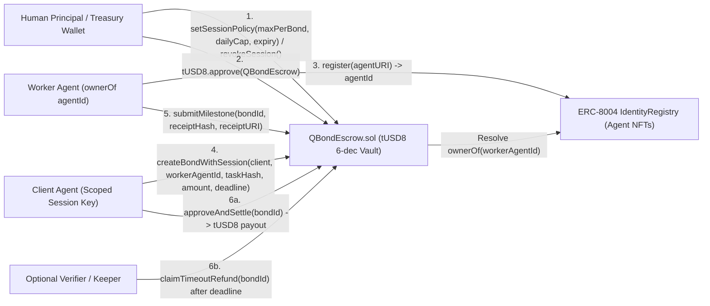

# QBond — Agent-to-Agent Milestone Escrow on QDay Aevum (`tUSD8`)

**QBond** is a programmable, zero-trust stablecoin milestone escrow and scoped session-key protocol built for the **Aevum Builder Challenge #1** on the **QDay Aevum Testnet (Chain ID `44005`)**.

It enables human principals and autonomous AI agents to fund task milestones in **`tUSD8` (6 decimals)**, verify worker agent identities via **ERC-8004**, enforce strict on-chain spending guardrails against prompt injection or compromised keys, and settle deterministically with verifiable on-chain receipts or permissionless timeout refunds.

---

## Problem Statement

Autonomous agents need to hire and pay specialist agents (for audits, data extraction, inference, or on-chain verification) without handing over unlimited ERC-20 `approve()` permissions or risking unfulfilled work. Standard token transfers expose treasuries to:
1. **Prompt-injection & runaway spending** when an agent holds an unscoped wallet key.
2. **Counterparty non-delivery** when funds are sent upfront without verifiable receipt checks.
3. **Opaque agent payouts** when worker endpoints lack an on-chain identity standard.

**QBond solves all three** in a single composable stack: **ERC-8004 Identity + Scoped Session Policy + `tUSD8` Milestone Escrow**.

---

## System Architecture



---

## QDay Aevum Testnet Configuration

| Parameter | Value |
|---|---|
| **Network Name** | QDay Aevum Testnet |
| **Chain ID** | `44005` (`0xABE5`) |
| **RPC / WebSocket** | `https://rpc-test.qday.info` / `wss://rpc-test.qday.info` |
| **Block Explorer** | `https://explorer-test.qday.info` |
| **Gas Token** | `tQDAY` (18 decimals) — Claim via `https://faucet.qday.info` |
| **Pinned Stablecoin (`tUSD8`)** | `0x456569838f1d43009A91ebA4263147Afd7233483` (**6 decimals**) |

---

## Deployed Testnet Contracts & Verification Proof

> **Action before final submission:** Run the Foundry deployment command below and replace the placeholder rows with your live deployed Aevum `44005` addresses and explorer transaction links.

| Contract / Proof | Address / Tx Hash | Explorer Link |
|---|---|---|
| `tUSD8` (Pinned Testnet Token) | `0x456569838f1d43009A91ebA4263147Afd7233483` | [View on Aevum Explorer](https://explorer-test.qday.info/address/0x456569838f1d43009A91ebA4263147Afd7233483) |
| `QBondIdentityRegistry` (ERC-8004) | `FILL_AFTER_DEPLOY` | `https://explorer-test.qday.info/address/FILL_AFTER_DEPLOY` |
| `QBondEscrow` | `FILL_AFTER_DEPLOY` | `https://explorer-test.qday.info/address/FILL_AFTER_DEPLOY` |
| Live Settlement Proof Tx | `FILL_AFTER_DEMO_RUN` | `https://explorer-test.qday.info/tx/FILL_AFTER_DEMO_RUN` |

---

## Repository Structure

```text
qbond/
├── contracts/
│   ├── foundry.toml
│   ├── src/
│   │   ├── interfaces/IERC8004.sol
│   │   ├── mocks/QBondIdentityRegistry.sol
│   │   └── QBondEscrow.sol
│   ├── test/QBondEscrow.t.sol          # Unit + fuzz test suite
│   └── script/DeployQBond.s.sol        # Aevum 44005 deploy script
├── packages/sdk/                       # Reusable MIT-licensed @qbond/sdk (viem)
├── agent-demo/                         # Live Client Agent <-> Worker Agent script
├── web/index.html                      # Single-file responsive dashboard (Netlify/Vercel ready)
├── netlify.toml
├── vercel.json
├── .env.example
└── LICENSE (MIT)
```

---

## Turnkey Setup & Reproduction Steps

### 1. Clone & Configure Environment

```bash
cp .env.example .env
# Fill DEPLOYER_PRIVATE_KEY (funded with tQDAY & tUSD8 from https://faucet.qday.info)
```

### 2. Install Foundry Dependencies & Run Unit + Fuzz Tests

```bash
cd contracts
forge install OpenZeppelin/openzeppelin-contracts --no-commit
forge install foundry-rs/forge-std --no-commit
forge test -vvv
```

Tests verify:
* Direct & scoped-session `tUSD8` milestone lifecycle (`FUNDED -> SUBMITTED -> SETTLED`)
* `ExceedsPerBondCap` and rolling 24h `ExceedsDailyCap` enforcement + 24h budget reset
* Instant 1-transaction `revokeSession()` lockout (`SessionNotActive`)
* Expiration enforcement (`SessionExpired`)
* Permissionless `claimTimeoutRefund()` after deadline expiry
* Neutral verifier rejection & client cancellation before delivery
* Fuzz testing on per-bond spend limits

### 3. Deploy & Verify on QDay Aevum (`44005`)

```bash
source ../.env
forge script script/DeployQBond.s.sol:DeployQBond   --rpc-url https://rpc-test.qday.info   --broadcast   --verify   --verifier blockscout   --verifier-url https://explorer-test.qday.info/api/
```

Copy the logged `QBondEscrow` and `QBondIdentityRegistry` addresses into `.env` and `DEFAULT_CONFIG` inside `web/index.html`.

### 4. Run the Autonomous Two-Agent Live Demo

```bash
cd ../agent-demo
npm install
npm run demo
```

This executes the end-to-end flow on Aevum `44005` (including a live simulated prompt-injection overspend dry-run) and prints clickable `explorer-test.qday.info/tx/...` proof URLs.

### 5. Deploy the Responsive Web Dashboard

Deploy `web/` directly to **Netlify** (`netlify.toml` preconfigured) or **Vercel** (`vercel.json` preconfigured), or open `web/index.html` locally via any static server (`npx serve web`).

---

## Reusable `@qbond/sdk` API Example

```ts
import { QBondClient } from "@qbond/sdk";

const qbond = new QBondClient({
  escrowAddress: "0xYOUR_DEPLOYED_ESCROW",
  identityRegistryAddress: "0xYOUR_DEPLOYED_REGISTRY"
});

const taskHash = QBondClient.hashPayload("Run smart contract security audit");
const txHash = await qbond.createBondWithSession(agentWalletClient, {
  client: "0xPRINCIPAL_ADDRESS",
  workerAgentId: 1n,
  taskHash,
  amount: QBondClient.parseTUSD8("15.00"),
  deadline: BigInt(Math.floor(Date.now() / 1000) + 3600)
});
```

---

## Safety, Trust & Known Constraints

* **Least-Privilege Guardrails:** Scoped session keys cannot exceed `maxPerBond`, `dailyCap`, or `expiresAt`, and can be terminated in 1 tx via `revokeSession()`.
* **Strict 6-Decimal Accounting:** `tUSD8` is pinned by address (`0x456569838f1d43009A91ebA4263147Afd7233483`) and handled via OpenZeppelin `SafeERC20` + `ReentrancyGuard`.
* **Testnet Scope:** Testnet tokens only (`tQDAY`, `tUSD8`); no mainnet value or token issuance.

## QDay Mainnet Roadmap

1. **Mainnet Launch (Feb):** Deploy audited `QBondEscrow` wired to canonical QDay mainnet `USD8` and ERC-8004 Identity + Reputation registries.
2. **Gasless Agent Settlement:** Integrate QDay's stablecoin paymaster + ERC-4337 smart accounts so worker agents pay zero native gas.
3. **x402 Hybrid Billing:** Pair micro-request x402 streams with QBond milestone escrows for long-running multi-agent workflows.
4. **Monetization:** Optional 0.15% protocol settlement fee on high-volume commercial agent marketplaces (0% on testnet/open-source builds).
